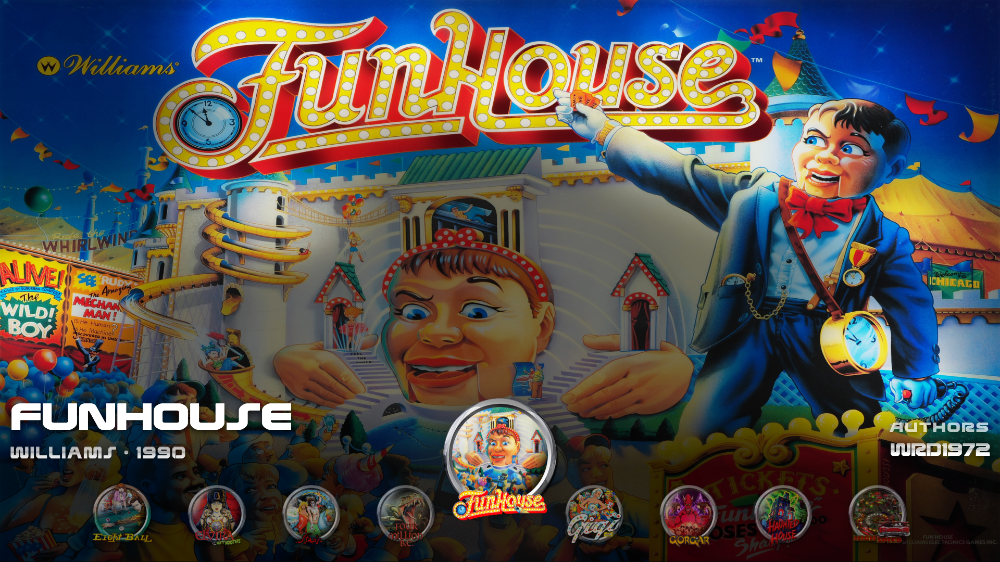

# Carousel Desktop

A theme for a desktop.  The backglass of the table you are on fills the screen.  Along the bottom, a dark band holds up to nine wheels with the selected one in the middle, larger and lifted above the rest.  Above the band, the table's name, manufacturer and year sit on the left and its authors on the right.

A table with no backglass falls back to its full single screen picture, and one with neither leaves the screen dark.  A table with no wheel is named in the row.

The row of wheels fits any screen shape.  The collection picker and the collection you start on are VPinFE's own.

## Install

Open Themes in the Console, find Carousel Desktop, and press Install.  Then press Make Active and restart VPinFE.  It needs VPinFE 3.0 or later.
